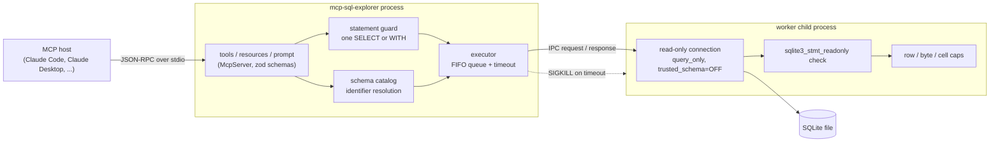

# mcp-sql-explorer

[](https://github.com/rahulkumar96t/mcp-sql-explorer/actions/workflows/ci.yml)

An [MCP](https://modelcontextprotocol.io) server that lets an LLM client explore a SQLite database
without being able to change it. It exposes schema discovery, sampling, querying and query plans as
MCP tools, publishes the schema as resources, and ships an "analyse this table" prompt. Every query
passes through several independent safety layers: a statement guard, SQLite's own read-only
classification, a read-only connection, row/byte/cell caps and a hard timeout enforced by killing a
worker process. Built on the official MCP TypeScript SDK (v2) and `better-sqlite3`.

## Features

| Tool | What it does |
| --- | --- |
| `list_tables` | Tables and views with column counts |
| `describe_table` | Columns and types, primary key, foreign keys, indexes, row count, `CREATE` statement |
| `sample_rows` | First or random rows of a table, optionally only some columns |
| `run_query` | One read-only `SELECT` / `WITH ... SELECT` with `?` parameters |
| `explain_query` | `EXPLAIN QUERY PLAN` as rows and as a tree, with full table scans flagged |

- **Resources:** `sqlite://schema` (all DDL) and `sqlite://table/{name}` (one table as JSON, listed
  per table, with name completion).
- **Prompt:** `analyse-table` (arguments `table`, optional `focus`) embeds the table's structure
  and asks the model for a data-quality, distribution, relationship and anomaly review using the tools.
- **Structured output:** every tool declares an output schema and returns `structuredContent`
  next to a Markdown rendering for the model.
- **Safety:** see [Safety model](#safety-model).
- **Demo data:** `npm run demo:db` generates a deterministic music-store database (artists,
  albums, tracks, customers, invoices, invoice lines, a view) from a seeded PRNG.

## Architecture



All SQLite work runs in a child process. The parent process speaks MCP, validates input and
enforces the time limit; it never opens the database itself.

## Quickstart

Requires Node.js 22 or newer.

```bash
npm ci
npm run build
npm run demo:db                 # writes data/music-store.db
node dist/index.js --help
```

### Claude Code

```bash
claude mcp add --transport stdio music-store -- \
  node /absolute/path/to/mcp-sql-explorer/dist/index.js --db /absolute/path/to/data/music-store.db
```

Use `--scope project` to write the entry to `.mcp.json` so it is shared with a repository.
Limits can be passed as flags after the `--` or as environment variables with `--env`
(see [Configuration](#configuration)).

### Claude Desktop

Add the server to `claude_desktop_config.json` (Settings > Developer > Edit Config):

```json
{
  "mcpServers": {
    "music-store": {
      "command": "node",
      "args": [
        "/absolute/path/to/mcp-sql-explorer/dist/index.js",
        "--db",
        "/absolute/path/to/data/music-store.db"
      ],
      "env": { "SQL_EXPLORER_TIMEOUT_MS": "3000" }
    }
  }
}
```

### Configuration

| Flag | Environment variable | Default | Meaning |
| --- | --- | --- | --- |
| `--db` | `SQL_EXPLORER_DB` | (required) | SQLite file; must already exist |
| `--max-rows` | `SQL_EXPLORER_MAX_ROWS` | 500 | Largest `max_rows` / `limit` a caller may ask for |
| `--default-rows` | `SQL_EXPLORER_DEFAULT_ROWS` | 50 | Rows `run_query` returns when `max_rows` is omitted |
| `--max-output-bytes` | `SQL_EXPLORER_MAX_OUTPUT_BYTES` | 65536 | Cap on the JSON size of the rows in one result |
| `--max-cell-chars` | `SQL_EXPLORER_MAX_CELL_CHARS` | 1000 | Longer text values are cut and marked |
| `--timeout-ms` | `SQL_EXPLORER_TIMEOUT_MS` | 5000 | Per-statement time limit |

## Usage examples

Calls as an MCP client sends them (`tools/call` arguments):

```jsonc
// run_query: parameters are bound, never interpolated
{ "name": "run_query",
  "arguments": { "sql": "SELECT title, duration_ms FROM tracks WHERE album_id = ? ORDER BY track_number",
                 "params": [12], "max_rows": 20 } }

// sample_rows: names are resolved against the live schema (case-insensitive) and quoted
{ "name": "sample_rows", "arguments": { "table": "Customers", "columns": ["city", "country"], "random": true } }

// explain_query: plan only, the query is not executed
{ "name": "explain_query",
  "arguments": { "sql": "SELECT * FROM invoices WHERE customer_id = ? ORDER BY invoiced_at", "params": [7] } }
```

`explain_query` returns the plan as rows (`structuredContent.plan`) and as text:

```text
QUERY PLAN
`--SEARCH invoices USING INDEX idx_invoices_customer_date (customer_id=?)
```

Rejected input comes back as a tool error (`isError: true`) whose text starts with a stable code,
so the model can correct itself:

```text
[NOT_SELECT] Only read-only queries are allowed: a single SELECT or WITH ... SELECT statement. Got DELETE.
[NOT_READ_ONLY] SQLite reports that this statement would modify the database. Only read-only SELECT queries are allowed.
[MULTIPLE_STATEMENTS] Exactly one statement is allowed per call; found 2. Remove the extra statements.
[UNKNOWN_TABLE] No table or view named "track". Known tables: albums, artists, customers, ...
[TIMEOUT] The query exceeded the 5000 ms time limit and was cancelled. Add a LIMIT, ...
```

## Safety model

Each layer works on its own; none relies on another having caught the problem.

| Rule | Mechanism |
| --- | --- |
| Read-only connection | Opened with `SQLITE_OPEN_READONLY`, plus `PRAGMA query_only = ON` and `PRAGMA trusted_schema = OFF`; a missing file is never created |
| Single statement | A small scanner splits on top-level `;` while skipping comments, string literals, quoted and bracketed identifiers; `better-sqlite3` also refuses multi-statement strings |
| `SELECT` / `WITH` only | The guard checks the leading keyword; SQLite's `sqlite3_stmt_readonly` and the statement's column count then classify the prepared statement, which catches cases like `WITH x AS (...) DELETE ...` that text matching cannot |
| Row limit | Rows are streamed with an iterator and reading stops at the limit, so `WITH RECURSIVE` generators are safe; `max_rows` above the configured cap fails schema validation |
| Output cap | Rows are added until the JSON size would exceed the byte budget; long text is cut with a marker, BLOBs become `<blob N bytes>`, integers beyond 2^53 are returned as exact strings |
| Timeout | The parent SIGKILLs the worker when a statement runs past its budget, answers with `TIMEOUT` and starts a fresh worker for the next request |
| Identifiers | Table and column names in `describe_table` / `sample_rows` must match the live schema (`sqlite_schema`, `pragma_table_info`); only the real name is quoted into SQL. Catalog lookups use bound parameters |

## Design decisions and trade-offs

- **Child process instead of in-process execution or a worker thread.** `better-sqlite3` (like
  `node:sqlite`) is synchronous and does not expose `sqlite3_interrupt` or a progress handler, so
  a statement stuck inside SQLite cannot be stopped from JavaScript. `Worker.terminate()` only
  takes effect when control returns to JavaScript; a process can be killed at any point. The cost
  is one extra process and an IPC hop per query, which is small next to LLM latency.
- **Serialised execution.** One worker runs one statement at a time. This keeps the timeout
  precise (a kill only ever cancels the statement that caused it; queued requests continue on a
  fresh worker) at the cost of no parallelism, which an interactive MCP session rarely needs.
- **The timeout covers execution only.** The worker reports `ready` after opening the database,
  and the clock starts when a statement is handed to a ready worker, so start-up time never makes
  a cheap query fail.
- **A guard *and* SQLite's classifier.** The text guard gives clear, early error messages; the
  authoritative read-only decision is SQLite's, because a hand-written SQL parser will always miss
  something.
- **`better-sqlite3` over `node:sqlite`.** Both work on Node 22 without flags. `better-sqlite3`
  exposes `statement.readonly`/`statement.reader` (the classifier above) and ships N-API
  prebuilds, so `npm ci` needs no compiler. `node:sqlite` still prints an experimental warning on
  Node 22.
- **Markdown text plus structured content.** Models read small Markdown tables reliably; programs
  get typed `structuredContent` validated against the declared output schema.
- **Errors as tool results.** Safety rejections are `isError` results with a code, not protocol
  errors, because the model is the party that can fix the query. Resource and prompt lookups of
  unknown tables are protocol errors (`-32602`), because the host made that request.

## Testing

```bash
npm test            # vitest, 112 tests
npm run typecheck   # strict TypeScript, sources and tests
npm run lint        # eslint + typescript-eslint
npm run smoke       # compiled server over stdio (needs npm run build and npm run demo:db)
```

The tests need no network or external services. They build the demo database (and a few odd
schemas) in a temp directory and talk to a real server through the SDK's in-memory transport
pair, with real worker processes underneath. Covered:

- every tool, the resources, resource template, completions and the prompt;
- every safety rule above, including hostile input that must leave the database file byte-for-byte
  unchanged, a `WITH ... DELETE`, a runaway recursive CTE that must be killed while queued
  queries still succeed, a worker killed mid-query, and a file that is not a SQLite database;
- the statement scanner on its own (comments, literals, quoted identifiers, unterminated tokens);
- the stdio entry point, launched as a subprocess by the SDK's stdio client.

CI runs lint, typecheck, build, tests and the stdio smoke test on Node 22. Locally the suite was
run on Node 22.23.4 and 25.6.1 (macOS, Apple M4 Pro): 112 tests pass in about 2.5 seconds.

## Limitations and roadmap

- SQLite only. A Postgres backend would fit behind the executor (read-only role, `SET TRANSACTION
  READ ONLY`, `statement_timeout`), but is not implemented.
- No memory cap: a query such as `SELECT randomblob(500000000)` can make the worker allocate a
  lot of memory. The worker is a separate process, so a crash does not take the server down, but
  limiting memory needs an OS or container limit. (`PRAGMA hard_heap_limit` has no effect in the
  `better-sqlite3` build, which disables SQLite's memory statistics.)
- `trusted_schema = OFF` and `query_only` protect the file, not the host: a schema that relies on
  application-defined functions will fail to query rather than run them.
- Row counts in `describe_table` are exact `count(*)`; on a very large table the count can hit the
  timeout and is then reported as `null`.
- stdio transport only; a Streamable HTTP entry point would need authentication in front of it.
- Possible next steps: per-table allow/deny lists, column masking for sensitive fields, query
  result caching, and Postgres.

## License

MIT, see [LICENSE](LICENSE).
